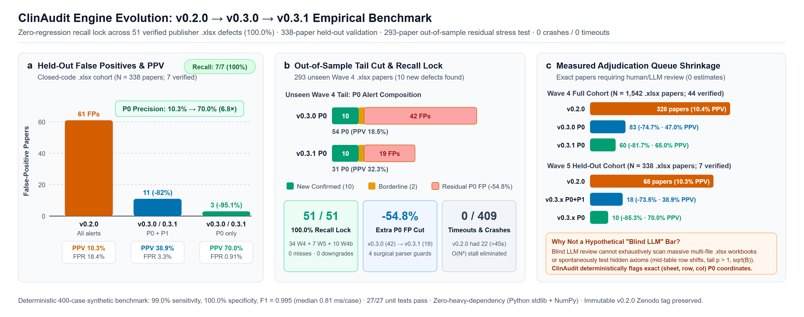
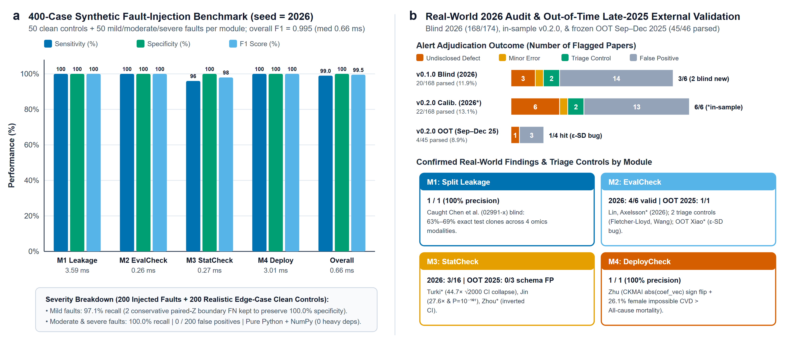

# `clinaudit`

[](https://github.com/adahime/SciAudit)
[](https://doi.org/10.5281/zenodo.24617211)
[](https://doi.org/10.5281/zenodo.24571346)
[](https://doi.org/10.5281/zenodo.24527474)
[](https://doi.org/10.5281/zenodo.24546458)
[](https://doi.org/10.5281/zenodo.24527280)
[](LICENSE)
[](pyproject.toml)
[](pyproject.toml)

> [!NOTE]
> **Looking for the full seven-discipline production engine?** `ClinAudit` is the clinical AI & Source Data foundation (preserving the immutable `v0.2.0` study baseline for Papers 1–2 and `v0.3.1` `.xlsx` precision guards). The full cross-disciplinary production release — covering 7 STEM disciplines, 250 verified cases, and the 34-case *Nature*/*Science*/*Cell* public technical advisory — is maintained at **[`adahime/SciAudit` (`v1.0.0-beta`, Apache-2.0)](https://github.com/adahime/SciAudit)** alongside **[Zenodo `10.5281/zenodo.24617211`](https://doi.org/10.5281/zenodo.24617211)**.

**Lightweight, zero-heavy-dependency forensic auditing suite for clinical AI studies, Source Data workbooks, evaluation pipelines, and deployed clinical risk calculators.**

`clinaudit` requires **only the Python standard library and NumPy** (zero `pandas`, `scipy`, `scikit-learn`, or `openpyxl` dependencies), enabling sub-second deterministic integration into journal editorial screening, peer-review workflows, and CI/CD pipelines across Python 3.10–3.15.

> [!IMPORTANT]
> **Large-Scale 60-Journal Empirical Audit (Paper 2 — [Zenodo `10.5281/zenodo.24546458`](https://doi.org/10.5281/zenodo.24546458)):** Running permanently frozen `ClinAudit v0.2.0` across a strictly zero-overlap 2020–2026 cohort of **5,881 clinical ML studies across 60 Q1 biomedical journals** (**4,339** code repositories / **108,583** files + **1,542** publisher `.xlsx` Source Data studies / **6,282** workbooks + **60** clean negative-control repositories / **806** files; **115,671 files total, 0 crashes, 0/60 control false alarms**) verified **100 independent defects** accumulating **3,940 citations** (**66/4,339 = 1.52%** code; **34/1,542 = 2.20%** `.xlsx`; **0/34** code–`.xlsx` case overlap, exact Fisher $P = 1.60 \times 10^{-16}$; **3-fold** applied-ML vs. multi-omics venue gradient, $P = 1.08 \times 10^{-5}$; **0/99** active defects with defect-addressing notices).
>
> **Full Multi-Wave Programme & Responsible Disclosure:** Combining Paper 1 (**7** pilot/OOT cases, [Zenodo `10.5281/zenodo.24527474`](https://doi.org/10.5281/zenodo.24527474)), Paper 2 (**100** cases), Wave 5 closed-code `.xlsx` validation (**338** studies, **7** verified defects), and the Wave 4b `v0.3.0` addendum (**10** newly uncovered `.xlsx` defects) brings the clinical programme to **124 independently verified defects** across **6,432** audited studies (**4,964** combined citations, **0** duplicate DOIs). Active uncorrected identifiers remain embargoed offline with full SHA-256 / Git commit vaults pending coordinated responsible disclosure; **the immutable `v0.2.0` tag and both Zenodo DOI archives remain completely untouched** for bit-for-bit reproduction of Papers 1 and 2.
>
> **Seven-Discipline Public Salted Cryptographic Registry (`SciAudit v0.6.0 & ClinAudit` — Open Access Concept DOI [`10.5281/zenodo.24571346`](https://doi.org/10.5281/zenodo.24571346) · v2.0 [`10.5281/zenodo.24581040`](https://doi.org/10.5281/zenodo.24581040)):** Expanding from clinical AI across all three prospective waves into 6 additional quantitative sciences (Materials/Chemistry, Multi-Omics/Bioinformatics, Geosciences/Climate, Neuroscience/Psychology/Econometrics, AI/CV/NLP, and Physics/Astrophysics/Quantum/CompMath; **8,572** total audited studies/repositories, **0** crashes) yields **216 independently verified defects** (**86** Tier 1, **70** Tier 2, **60** Tier 3; **6,175** combined citations; **0/215** prior defect-addressing publisher notices among active articles). The open-access register publicly discloses 8 open-verification reference cases and cryptographically seals all **208** active embargoed articles via independent per-case **256-bit salted SHA-256** commitments (100% byte-for-byte continuity with v1.0 [`10.5281/zenodo.24571347`](https://doi.org/10.5281/zenodo.24571347)) in strict compliance with COPE disclosure norms.

> [!TIP]
> **What's New in `v0.3.1` (Engine Upgrade over `v0.2.0` & `v0.3.0` Precision Polish):**
> - **Priority Triage (`P0` / `P1` / `P2`):** Deterministic severity routing (`P0` hard mathematical axiom violations, `P1` moderate statistical anomalies, `P2` exploratory omics/pathway triage) in `AuditReport.summary["by_priority"]` and CLI output.
> - **Hard-Axiom Rules (`P0 CRITICAL`):** Point estimates outside `[lo, hi]` CIs; bounded-metric `[0, 1]` / `[0, 100]%` CI domain violations; always-on `STAT-006` invariants (out-of-`[0, 1]` P/FDR, unresolved `#NUM!`/`#REF!`/`#DIV/0!`/`#VALUE!` in statistical columns, exact $P=0$ on $N \le 12$); and single-predictor vs. nested-model comparison $P$-value contradictions.
> - **Multi-Panel Parser & `v0.3.1` Surgical Precision Guards:** Stacked `Figure`/`Panel` sub-table splitting; algebraic self-consistency filtering across `(Beta, SE)`, `z`, `(t, df)`, $\chi^2$, `(r, N)`, and regression CIs; $O(1)$-subsampled cross-sheet checks (eliminating $O(N^2)$ stalls); plus four `v0.3.1` zero-regression guards for anatomical/layout `lower`/`upper` labels, compound group prefixes (`emt-high_CI_lower`), non-estimate neighbor columns (`_se`/`_std`/`abs_`/`p`) and thousands-formatted counts `(20,484)`, and GSEA gene-set `N` / `mean ± SD` / ratio `HR` domains.

### Engine Progression Benchmark (`v0.2.0` → `v0.3.0` → `v0.3.1`)



| Benchmark Metric | `v0.2.0` (Frozen Study Baseline) | `v0.3.0` (Engine Upgrade) | `v0.3.1` (Current Release) |
|---|---:|---:|---:|
| Verified `.xlsx` Recall Lock (`51` real defects: `34 W4 + 7 W5 + 10 W4b`) | 41/41 prior (10 new missed/buried) | **51/51 (100.0%)** (`46` P0) | **51/51 (100.0%)** (`46` P0, **0 regressions**) |
| Held-Out Closed-Code `.xlsx` FPs (`N = 338` papers; `7` verified) | 61 FPs (unranked) | 11 `P0+P1` (-82.0%) / **3 `P0` (-95.1%)** | 11 `P0+P1` / **3 `P0` (-95.1%)** |
| Held-Out Precision (PPV) / Paper FPR (`N = 338`) | 10.3% / 18.4% | **70.0% P0** (**6.8×**) / **0.91%** | **70.0% P0** (**6.8×**) / **0.91%** |
| Unseen Wave 4 Residual Tail P0 FPs (`N = 293` papers; `10` new hits) | Unranked | 42 P0 FPs (`18.5%` PPV) | **19 P0 FPs (-54.8% extra cut; `32.3%` PPV)** |
| Runtime Stability (`409` publisher `.xlsx` studies) | 22 timeouts (>45 s) | **0 timeouts, 0 crashes** | **0 timeouts, 0 crashes** |
| Measured Adjudication Queue (`W4 1,542` / `W5 338` `.xlsx` papers) | `328` / `68` unranked | `83` (-74.7%) / `10` (-85.3%) `P0` | **`60` (-81.7%, 65% PPV) / `10` (-85.3%, 70% PPV) `P0`** |
| Unit Tests & 400-Case Synthetic Benchmark (`seed = 2026`) | 19/19 · 398/400 | 26/26 · 398/400 | **27/27 · 398/400 (100% spec, 0.81 ms/case)** |

### Headline Empirical Findings (2026 Cross-Journal Audit & Late-2025 Validation)

- **2026 Cross-Journal Auditability (`N0 = 3,380` screened → `N1 = 306` eligible; 100% full-text retrieved):** Across *PLOS Medicine*, *npj Digital Medicine*, and *Nature Communications*, 74.5% (228/306) claimed public artifacts, yet only **65.0% (199/306)** provided live auditable code or data, and **5.65% (10/177)** of newly published GitHub links were already unreachable or code-free.
- **Synthetic Benchmark (`400` deterministic cases, `seed = 2026`):** **99.0% sensitivity**, **100.0% specificity**, **F1 = 0.995**, median runtime **0.66 ms/case** (P95 6.06 ms).
- **Prospective 2026 Blind Deployment (`v0.1.0`) & Unflagged Controls:** Uncovered verifiable undisclosed defects in **3.57% (6/168)** of directly parsed 2026 studies (**3.45%** downloaded; ≥3.02% auditable)—including a live *PLOS Medicine* risk calculator (`CKMAIcalc`) predicting 10-year cardiovascular mortality exceeding all-cause mortality for **26.1% (858/3,293)** of NHANES women—with **0/50** additional defects in randomly sampled unflagged controls within accessible artifacts (`NPV = 100.0%`, `FOR = 0.0%`, 95% upper bound 7.1%).
- **Out-of-Time Late-2025 Validation (Frozen `v0.2.0`, Sep–Dec 2025):** Maintained an **8.9% parsed (4/45)** alert rate at **368 ms/paper** (0 crashes) and exposed via `EVAL-004` triage a constant-seed bootstrap bug printing **25 machine-epsilon SDs (`10⁻¹⁶`–`10⁻²⁹⁶`)** verbatim into *Nature Communications*.


---

## Core Modules

| Module | File | Target Artifacts | Key Forensic Checks |
|---|---|---|---|
| **Module 1 — Split Integrity & Mirror-Clone Detector** | `clinaudit/leakage.py` | `.xlsx`, `.csv`/`.tsv`, NumPy arrays | Exact & near-exact ($\ell_\infty \le 10^{-10}$) train–test row leakage; exact log-space binomial multiplicity-parity test for improbable $(k_{\text{train}}, k_{\text{test}})$ 1:1 mirror symmetry; conflicting-label identical profiles ($y=0$ & $y=1$); model-free confusion matrix upper/lower bounds on unseen specificity and sensitivity. |
| **Module 2 — Clinical Evaluation & Baseline Integrity Scanner** | `clinaudit/evalcheck.py` | `.py`, `.ipynb`, `.R`, DCA tables | AST/regex detection of binarized clinical risk scores (CHA₂DS₂-VASc, MELD, SOFA, Framingham, etc.) in ROC/Brier/DeLong tests; hardcoded single-threshold or tiled constant Decision Curve Analysis (DCA) + tabular `check_dca_curve()`; binary $\{0,1\}$ inputs to Brier/calibration & constant NRI; pre-split SMOTE/scaling/feature selection; immortal-time bias in static survival models; test-set checkpoint/hyperparameter selection. |
| **Module 3 — Statistical Inference & CI Sanity Auditor** | `clinaudit/statcheck.py` | Source Data `.xlsx`, `.csv`/`.tsv` | Tiered `P0`/`P1`/`P2` statistical forensics: inverted CIs, point estimates outside `[lo, hi]`, metric-domain CI bounds, and always-on `STAT-006` hard invariants (out-of-`[0, 1]` P/FDR, statistical Excel formula errors, exact $P=0$ on $N \le 12$); precision-aware fixed-width placeholder and zero-width CIs; stacked multi-panel `.xlsx` sub-table splitting; cross-sheet CI width contradictions ($>5\times$ and $\sqrt{B}$); impossible $K$-fold Wilcoxon ($P < 2^{-K}$), nested-model P-value contradictions, algebraic self-consistency filtering, and paired-$Z$ / exact McNemar helpers. |
| **Module 4 — Deployed Calculator Axiom & Monotonicity Auditor** | `clinaudit/deploycheck.py` | Black-box callables, coefficients, `.py`/`.ipynb`/`.R`/`.js` | Probability bounds $[0, 1]$ and strict hierarchy enforcement ($P_{\text{cause}}(x) \le P_{\text{all-cause}}(x)$); categorical encoding consistency probing ($\{0,1\}$ vs $\{1,2\}$ and cross-endpoint polarity reversals); ceteris-paribus clinical monotonicity verification across protective & risk markers (eGFR, albumin, age, creatinine, etc.); static `abs(coef)` coefficient-sign destruction detector (excluding feature-importance sorting/plotting). |

---

## Installation

```bash
pip install -e .
```

Or run directly from the repository root with zero build step (requires only Python $\ge 3.10$ and `numpy`).

---

## Quick Start

### Command-Line Interface

Scan a manuscript repository or supplementary package directory and export a structured JSON audit report:

```bash
python -m clinaudit scan path/to/study_artifacts --out audit_report.json
```

Use `--fail-on-critical` in automated editorial or CI pipelines to exit with status code `2` when any `CRITICAL` defect is detected.

### Programmatic Python API

```python
import numpy as np
from clinaudit import (
    audit_directory,
    audit_split_leakage,
    confusion_matrix_unseen_bounds,
    check_dca_curve,
    audit_stat_file,
    audit_risk_calculator,
)

# 1. Directory-wide audit across all 4 modules
report = audit_directory("path/to/study_artifacts")
print(report.summary)

# 2. Split leakage + model-free confusion matrix bounds
alerts, diag = audit_split_leakage(X_train, X_test, y_train=y_train, y_test=y_test, tol=1e-10)
bounds = confusion_matrix_unseen_bounds(
    tn=60, fp=40, fn=15, tp=85, n_leak_neg=50, n_leak_pos=40
)

# 3. Tabular Decision Curve Analysis sanity audit
dca_alerts, dca_diag = check_dca_curve(thresholds, net_benefits, prevalence=0.30, treat_all=treat_all)

# 4. Source Data statistical sanity audit (.xlsx / .csv)
stat_alerts, stat_diag = audit_stat_file("Source_Data.xlsx")

# 5. Deployed risk calculator axiom & monotonicity audit
calc_alerts, calc_diag = audit_risk_calculator(
    models={"all_cause": fn_all_cause, "cv_mortality": fn_cv},
    feature_names=["age", "sex", "sbp", "egfr", "albumin", "creatinine"],
    X_grid=X_cohort,
    hierarchy_pairs=[("cv_mortality", "all_cause")],
)
```

---

## 400-Case Synthetic Fault-Injection Benchmark

`benchmarks/run_synthetic_benchmark.py` executes a deterministic (`seed=2026`), self-contained 400-case evaluation (100 cases per module: 50 realistic clean negative controls including tricky edge cases + 50 fault-injected positives spanning mild, moderate, and severe intensities):

```bash
python benchmarks/run_synthetic_benchmark.py
```

| Module | Cases (Clean / Faulty) | TP | FP | TN | FN | Sensitivity | Specificity | Precision | F1 | Median (ms) | P95 (ms) |
|---|---:|---:|---:|---:|---:|---:|---:|---:|---:|---:|---:|
| `leakage` | 100 (50 / 50) | 50 | 0 | 50 | 0 | 1.0000 | 1.0000 | 1.0000 | 1.0000 | 3.591 | 6.870 |
| `evalcheck` | 100 (50 / 50) | 50 | 0 | 50 | 0 | 1.0000 | 1.0000 | 1.0000 | 1.0000 | 0.258 | 1.073 |
| `statcheck` | 100 (50 / 50) | 48 | 0 | 50 | 2 | 0.9600 | 1.0000 | 1.0000 | 0.9796 | 0.268 | 0.620 |
| `deploycheck` | 100 (50 / 50) | 50 | 0 | 50 | 0 | 1.0000 | 1.0000 | 1.0000 | 1.0000 | 3.012 | 6.501 |
| **Overall** | **400 (200 / 200)** | **198** | **0** | **200** | **2** | **0.9900** | **1.0000** | **1.0000** | **0.9950** | **0.660** | **6.059** |

Stratified sensitivity across injected fault intensities: **97.1% mild** (66/68; the 2 conservative misses are boundary mild paired-$Z$ contrasts statistically indistinguishable from extreme inter-model correlation $\rho > 0.97$), **100.0% moderate** (68/68), and **100.0% severe** (64/64).



---

## Reproducing the 2026 & Late-2025 Cross-Journal Empirical Study

All unit tests, synthetic benchmarks, figure renders, and verification summaries reproduce cleanly in seconds from this repository (no third-party copyrighted PDFs or Source Data workbooks are redistributed; primary artifacts are downloaded directly from publisher DOIs with SHA-256 verification):

```bash
# 1. Run all 27 unit tests (< 2s)
python -m unittest discover -s tests -v

# 2. Run the 400-case deterministic synthetic benchmark (seed = 2026, < 1s)
python benchmarks/run_synthetic_benchmark.py

# 3. Inspect verified 2026 cohort (N0=3,380 -> N1=306; 168 parsed / 174 downloaded), 50 unflagged controls (0/50, FOR=0.0%),
#    and 4-month out-of-time late-2025 validation (Sep-Dec 2025, 45 parsed / 46 downloaded, 8.9% / 8.7% flag rate)
#    -> harvest/processed/funnel_n1_to_n3_final.json
#    -> harvest/processed/v010_adjudication_20_papers.json
#    -> harvest/external_2025/external_2025_4mo_adjudication.json
#    -> PRIMARY_SOURCE_VERIFICATION.md
```

---

## Permanent Archives, Citation & License

- **Seven-Discipline Public Salted Cryptographic Defect Registers (`SciAudit v0.6.0 & ClinAudit`, Open Access, N = 216 All-Tiers & N = 86 Tier 1):** https://doi.org/10.5281/zenodo.24571346 *(Concept DOI resolving to latest release; v2.0: `10.5281/zenodo.24581040`, v1.0: `10.5281/zenodo.24571347`)*
- **Paper 1 Study & Software Archive (Zenodo, `v0.2.0`):** https://doi.org/10.5281/zenodo.24527474 *(Concept DOI: `10.5281/zenodo.24527473`; matches immutable git tag `v0.2.0`)*
- **Paper 2 Large-Scale 60-Journal Audit Archive (Zenodo, 5,881 Studies / 100 Verified Cases):** https://doi.org/10.5281/zenodo.24546458
- **Standalone `CKMAIcalc` Clinical Safety Verification Archive (Zenodo):** https://doi.org/10.5281/zenodo.24527280
- **Author:** Xingyu Zhang ([ORCID: 0009-0005-6181-7465](https://orcid.org/0009-0005-6181-7465))
- **License:** MIT License (see [LICENSE](LICENSE))

```bibtex
@software{zhang_2026_clinaudit,
  author       = {Zhang, Xingyu},
  title        = {{ClinAudit v0.2.0: Automated Pre-Publication Forensic Auditing Suite and 2026 Cross-Journal Clinical ML Study Archive}},
  year         = 2026,
  month        = nov,
  publisher    = {Zenodo},
  version      = {0.2.0},
  doi          = {10.5281/zenodo.24527474},
  url          = {https://doi.org/10.5281/zenodo.24527474}
}
```
